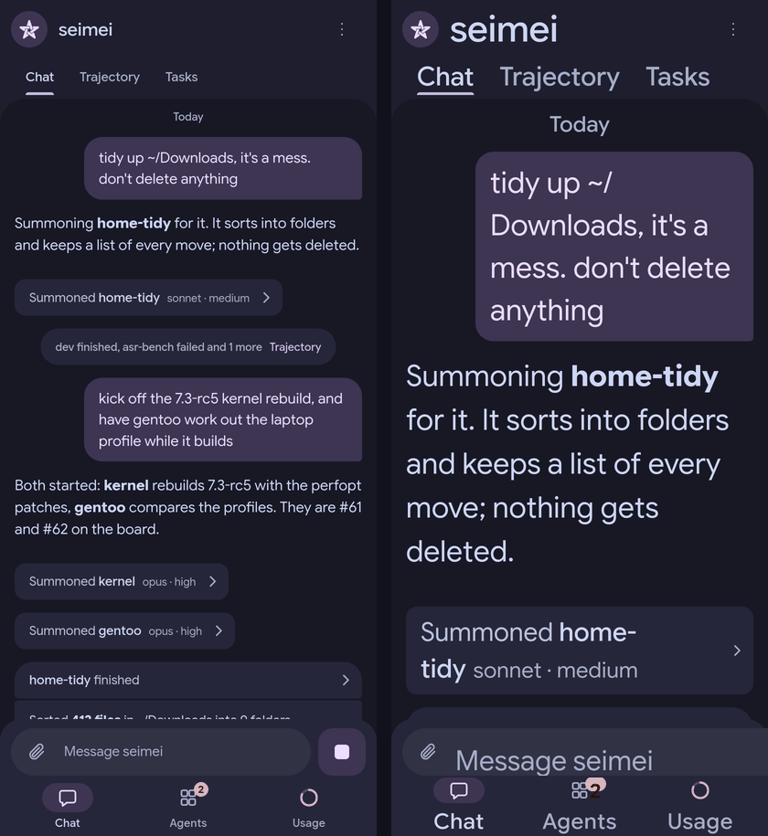
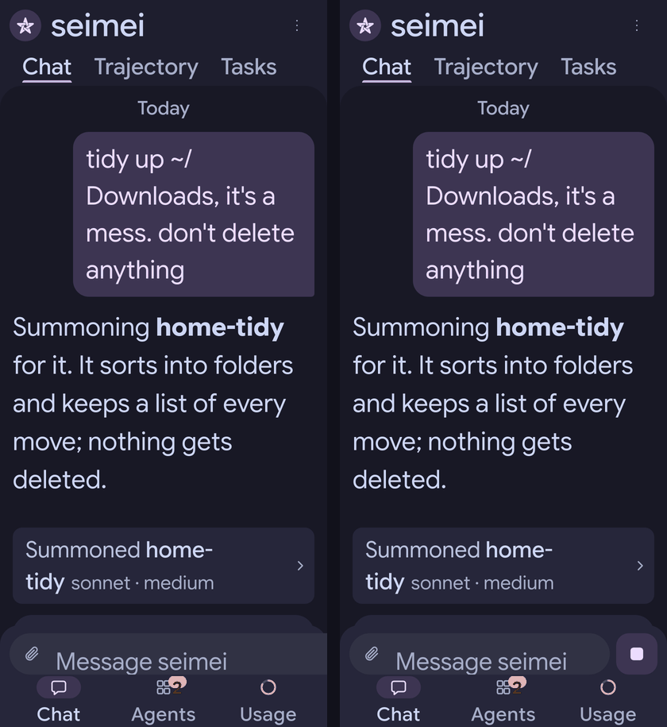
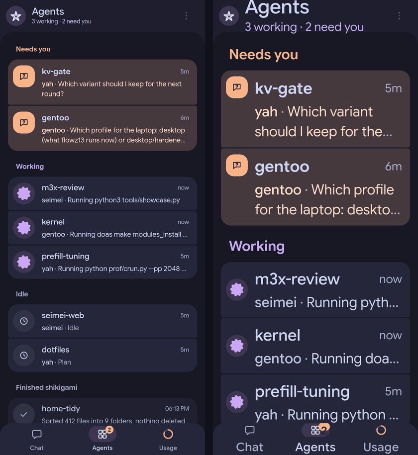
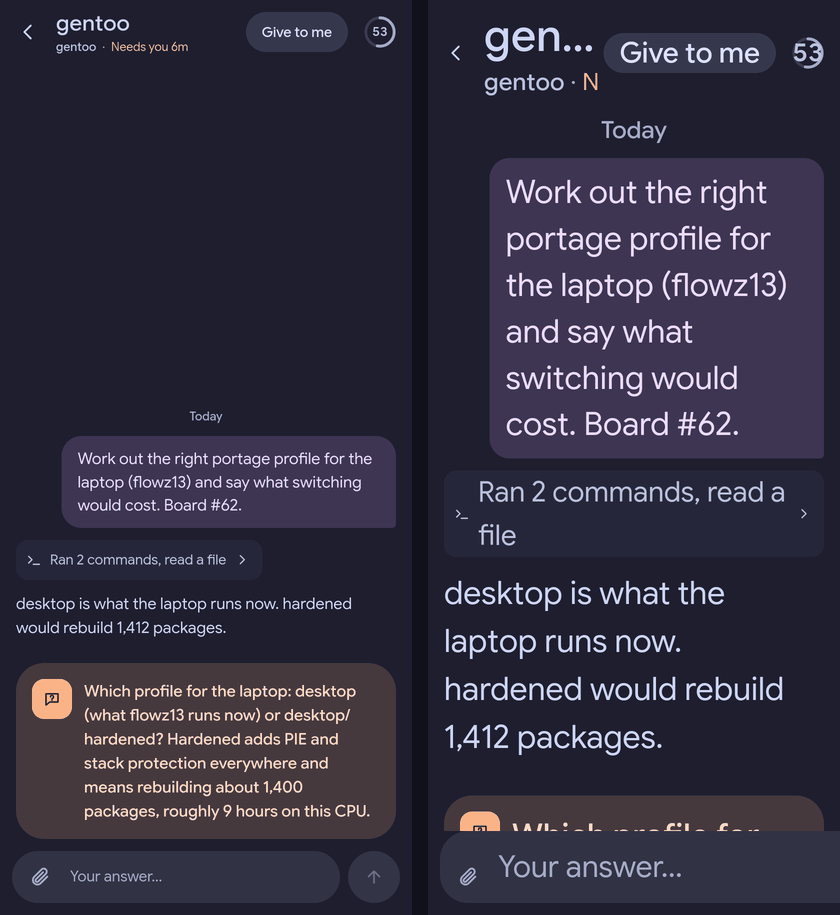
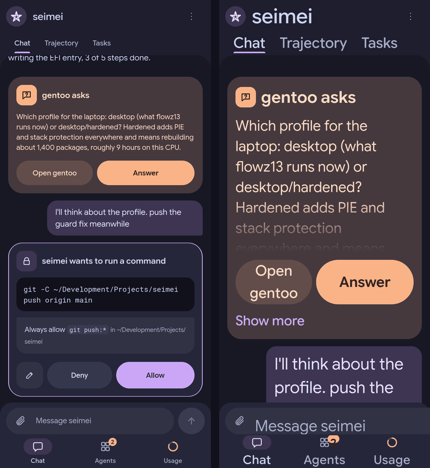
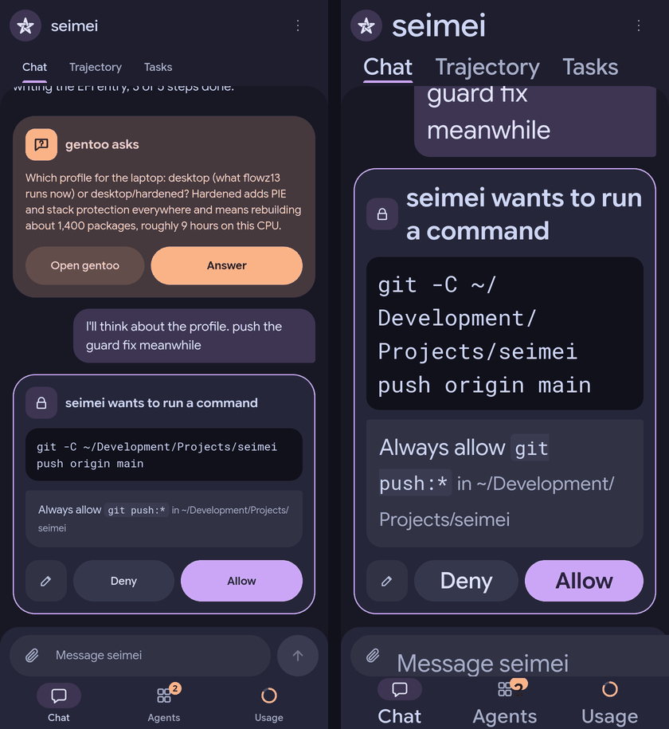

# M3 behavior review

The non-visual half of [REVIEW.md](REVIEW.md): how seimei moves, goes back, undoes, notifies, talks to screen readers, buzzes, scrolls and waits, checked against Material 3 and the Android guidelines. Every guideline below was read from its source page for this review (m3.material.io pages rendered in a browser, androidx and AOSP source files fetched raw), not recalled. Code references are `file:line` in this repo; `A/` is `android/app/src/main/java/com/hisamiowo/seimei/`.

Scope of the measurements. The 200% renders are of the showcase pages (the M3X design on top of `web/style.css`) with Firefox text zoom, which scales every size linearly; Android's own 200% is gentler (its nonlinear curve takes 14sp to 26dp, not 28, per AOSP `FontScaleConverterFactory`). Android findings come from reading the code: there is no emulator or device in this review. Contrast was measured on the dark theme only, because the showcase pins it.

The user this ranks for is phone first and mostly answers cards: approvals, questions and reviews. Anything that slows or hides an answer ranks high; motion polish ranks low.

## Top list

| # | Change | Why it matters for answering cards | Effort | Topic |
|---|---|---|---|---|
| 1 | One notification per pending approval, grouped, each with its own Allow and Deny | Today two waiting cards collapse into "2 approvals waiting" with no buttons, so the second card always costs an app open and a fingerprint | M | [4](#4-notifications-as-ui) |
| 2 | Show that an answer is sending, and say when it failed | Approve and Deny fail silently on both shells: the buttons just come back. The user thinks the card was answered and the shikigami waits | S | [9](#9-feedback-timing) |
| 3 | Fix the 200% text breaks: web composer, fixed 64px bars, Android card body clip | At 200% the web Send and Stop buttons leave the screen; on Android a 350 character question clips with no "Show more" even at 100% | S | [6](#6-accessibility) |
| 4 | One quiet live region for new cards instead of live threads; a TalkBack announcement on Android | With a screen reader the web reads every change to the whole thread, and Android says nothing when a card arrives | S to M | [6](#6-accessibility) |
| 5 | Reply from the shade on the reply ping (RemoteInput) | The pings seimei chooses to send are the ones that want an answer; today each one is an app open | M | [4](#4-notifications-as-ui) |
| 6 | Haptics that confirm an answer landed and mark the swipe threshold | One haptic exists today, and it uses the long press type for a swipe | S | [7](#7-haptics) |
| 7 | Undo on ticking a task; web snackbars with Undo stay until used; Unpair as a real M3 dialog | Ticking is optimistic with no way back but tapping again; web Undo disappears after 6 s | S | [3](#3-undo-instead-of-confirm) |
| 8 | Scroll: per-lane memory on Android, jump to latest with a count on the web, top bar tint on scroll | Android drops the reading position on every lane switch; the web has no way back to the newest card except scrolling | S to M | [8](#8-scroll-behavior) |
| 9 | Transitions: Lateral for the lanes, Top level for the nav bar, forward and backward for pages, reduced motion respected | Every screen change is a jump cut; the chat rise animation ignores reduced motion | M | [1](#1-screen-transitions) |
| 10 | Predictive back on the shikigami page | Android 14+ users get a preview everywhere else; seimei's page vanishes on commit | S to M | [2](#2-predictive-back) |
| 11 | Writing rules for notifications, dialogs and snackbars | Approval titles hit the 29 character notification limit; one notification names the app | S | [5](#5-writing) |

## 1. Screen transitions

**Names.** M3 renamed the patterns. Shared axis X is now **Lateral**, fade through is now **Top level**, container transform keeps its name, and the forward and back movement between a list and a page is **Forward and backward**. Sources: [transition patterns](https://m3.material.io/styles/motion/transitions/transition-patterns), [applying transitions](https://m3.material.io/styles/motion/transitions/applying-transitions).

**M3 says.** Lateral is for tabs: "elements are grouped and slide in unison", and it "does not use a fade". Top level is for the nav bar: "The exiting screen quickly fades out and then the entering screen fades in", and "A lateral transition pattern is not recommended for this type of navigation", because it "conflicts with carousels or swipe-able list items". Container transform is "highly effective" for shallow hierarchies, but "Container transform transitions require custom implementations and the motion may feel excessive when used frequently". For forward and backward, "Both Android and iOS should use platform defaults". "Jump cuts should generally be avoided". For reduced motion: "Use subtle fades instead of intense sliding or scaling".

**Which spring tokens.** M3 answers this itself: "M3 transitions use the legacy easing and duration system", and "Common transitions should not use overt style effects like bouncy springs". So screen transitions take the legacy tokens from androidx [MotionTokens.kt](https://github.com/androidx/androidx/blob/androidx-main/compose/material3/material3/src/commonMain/kotlin/androidx/compose/material3/tokens/MotionTokens.kt): emphasized decelerate `(0.05, 0.7, 0.1, 1)` for what enters, emphasized accelerate `(0.3, 0, 0.8, 0.15)` for what leaves, durations from the Short and Medium steps (50 to 400 ms). The expressive spatial springs ([how it works](https://m3.material.io/styles/motion/overview/how-it-works), [specs](https://m3.material.io/styles/motion/overview/specs)) stay on components the finger touches, as [REVIEW.md](REVIEW.md) already says; fades may use the effects springs, which never overshoot (web: default effects `cubic-bezier(0.34, 0.80, 0.34, 1.00)` at 200 ms, fast at 150 ms). The web's `--ease` (`web/style.css:71`) is already emphasized decelerate.

**seimei now.**
- Web nav and lanes: `show()` toggles `hidden` (`web/app.js:28-47`), a jump cut.
- Web shikigami page: it fades in over 0.2 s and has no exit animation (`web/style.css:809`).
- Web chat rows: every new row rises over 0.35 s (`web/style.css:193`), and reduced motion only covers the spinners.
- Android lanes and nav: `when (vm.tab)` is a jump cut (`A/Ui.kt:495-499`).
- Android shikigami page: it's an overlay `Surface` with no enter or exit animation (`A/Agents.kt:490-497`).

**Gap.** Jump cuts everywhere M3 asks for a pattern, and one animation that ignores reduced motion.

**Proposal.**
- Chat, Trajectory and Tasks lanes: Lateral. Both screens slide together, in the direction of the tab order, with no fade. Use about 300 ms with emphasized decelerate for the incoming screen. Web: two WAAPI `translateX` animations on the lane containers. Android: `AnimatedContent(vm.lane)` with `slideInHorizontally` / `slideOutHorizontally` and `MotionTokens` easing.
- Chat, Agents and Usage nav: Top level. The old screen fades out in about 100 ms, then the new one fades in over about 200 ms. Android: `AnimatedContent(vm.tab)` with `fadeIn` / `fadeOut` and those durations.
- Row or card to its shikigami page: forward and backward, not container transform. Opening a page is the most frequent move in the app, which is exactly where M3 warns the transform "may feel excessive". Android gets the system default once the page uses predictive back (topic 2). On the web, the page slides in from the end edge and back out on close: the exit is missing today.
- Reduced motion: wrap `web/style.css:193` in `@media (prefers-reduced-motion: no-preference)`, or swap it for a plain fade. Every new web transition needs the same fallback.

**Effort.** M (S per pattern, four of them, across two shells).

## 2. Predictive back

**Android says.** From [predictive back](https://developer.android.com/guide/navigation/custom-back/predictive-back-gesture): on Android 15+, apps that opt in get the system animations. "If your app enables an OnBackPressedCallback ... with PRIORITY_DEFAULT ... the predictive back animations don't run". `PredictiveBackHandler` gives the gesture progress as a flow and needs activity-compose 1.8.0 or newer. Intercepting back at the root "disables the back-to-home animation" ([Compose setup](https://developer.android.com/develop/ui/compose/system/predictive-back-setup)). The [design guide](https://developer.android.com/design/ui/mobile/guides/patterns/predictive-back) gives the motion:
- The outgoing screen scales from 100% to 90%, with an 8dp margin.
- The incoming screen scales from 110% to 100%.
- The fade-through threshold is 35% of the gesture.
- On cancel, the content returns.

**seimei now.**
- Opted in: `enableOnBackInvokedCallback="true"` (`android/app/src/main/AndroidManifest.xml:18`), with activity-compose 1.13.0 (`android/app/build.gradle.kts:121`).
- The tab handler `BackHandler(vm.tab != "chat")` (`A/Ui.kt:466`) is only enabled away from Chat. At the root, back-to-home keeps its system animation, which is right.
- The archive list (`A/Agents.kt:345`) and the shikigami page (`A/Agents.kt:492`) use plain `BackHandler`. The gesture shows no preview, and on commit the page disappears in one frame.
- Web: the page, sheet, archive and viewer push history (`web/agents.js:1046`, `web/util.js:182`). `popstate` closes them (`web/app.js:70-77`), so the browser's own back gesture works.

**Gap.** The one deep screen, the shikigami page, has no preview and no exit motion.

**Proposal.**
- Android: replace the page's `BackHandler` with `PredictiveBackHandler`.
  - While the gesture runs, scale the page by `1 - 0.1 * progress` and offset it toward the swipe edge, using the 8dp margin and the page's corner radius.
  - On commit, finish the exit with emphasized accelerate.
  - On cancel, animate back to 1.
  - Do the same for the archive list.
  - The details toggle inside the page (`pg.details`) stays a plain handler: it's a state change, not a screen.
- Web: no custom edge swipe, because it would fight the browser's and the OS's own gesture. Animate the page out on `popstate` instead (topic 1).

**Effort.** S to M: one screen, plus one shared modifier the archive list can reuse.

## 3. Undo instead of confirm

**M3 says.** From [snackbar](https://m3.material.io/components/snackbar/guidelines): "To allow users to amend choices, display an 'Undo' action". "Snackbars with actions should remain on screen until the user takes an action". On the web: "Actionable snackbars shouldn't auto-dismiss". From [dialogs](https://m3.material.io/components/dialogs/guidelines): "Don't use dialogs for low- or medium-priority information. Instead use a snackbar". A dialog's confirm button names the action, not "OK". From [UX writing](https://m3.material.io/foundations/content-design/style-guide/ux-writing-best-practices): "Tell users what will happen if they take an action and how they can undo it".

**seimei now, per action.**

| Action | Now | Proposal |
|---|---|---|
| Archive a shikigami | Undo snackbar on both shells (`web/agents.js:241-255`, `A/Seimei.kt:1070`) | Keep |
| Tick one of the user's own tasks | Optimistic, no Undo (`web/tasks.js:134-145`, `A/Seimei.kt:739-753`) | Undo snackbar ("Done" + Undo) once the row leaves the open list; required anyway once swipe to complete lands ([REVIEW.md](REVIEW.md) Tasks) |
| Approve or deny a card | Immediate, no dialog, no Undo | Keep immediate: the shikigami acts at once, so it isn't reversible, and a dialog would double the taps. Add the sending state from topic 9 |
| Unpair a device | Native `confirm()` with OK and Cancel (`web/account.js:181`) | Stays a dialog: it's irreversible (the device needs a new code). Make it an M3 dialog: headline "Unpair Pixel 9?", body "It needs a new pairing code to come back", buttons Cancel and Unpair |
| Log out | No confirm (`web/account.js:57`) | Keep: logging in again undoes it |

**Snackbar timing.** The web hides a snackbar with Undo after 6 s (`web/util.js:140`). M3 says that snackbar shouldn't auto-dismiss on the web. Keep it until the user acts, or until the next snackbar replaces it. Android shows Undo for `SnackbarDuration.Long` (`A/Ui.kt:488`), about 10 s by choice, per the comment at `A/Ui.kt:487`. That's a defensible trade on a phone, but M3 says to leave it up, so let it stay until the user acts or navigates away. The web snackbar is `role="status"` (`web/index.html:85`), which matches M3's "announce the message but don't move focus".

**Effort.** S.

## 4. Notifications as UI

**Android says.**
- From [build a notification](https://developer.android.com/develop/ui/views/notifications/build-notification): up to three actions, which "must not duplicate" the tap action. After a direct reply, "update the notification ... with the same ID ... to hide the direct reply UI and confirm". Use a unique `PendingIntent` request code per conversation.
- From [groups](https://developer.android.com/develop/ui/views/notifications/group): group only when every child makes sense alone and the children "have actions specific to each notification". A group needs a summary (`setGroupSummary(true)`). The system auto-groups at four notifications.
- From [channels](https://developer.android.com/develop/ui/views/notifications/channels): one channel per type. A channel's importance can't change after it's created. Apps may deep-link to the channel's settings.
- From the [design guide](https://developer.android.com/design/ui/mobile/guides/home-screen/notifications): Reply is for short text, and stale notifications should be dismissed.

**seimei now.**
- Channels (`A/Push.kt:30-43`):

  | Channel | Importance |
  |---|---|
  | approval | HIGH |
  | listen | MIN |
  | quiet | LOW |
  | ping | DEFAULT |
  | urgent | HIGH |

  The question and reply channels are deleted by the rules of 2026-10-20 (`A/Push.kt:69-71`): seimei decides what pings, and questions don't notify. This review keeps that decision.
- Approvals:
  - One card gives "{who} wants to {target}" with the detail as the body (`crates/core/src/push.rs:711-719`).
  - Two or more give "{n} approvals waiting" with the names and no card id (`crates/core/src/push.rs:720-723`), so the app adds no actions (`A/Push.kt:108-110`).
  - Everything shares one slot, tag "approval", id 0 (`A/Push.kt:123`).
- Allow and Deny:
  - They need API 31+, the unlocked session (`A/Push.kt:61-62`, audit P2) and `setAuthenticationRequired(true)`.
  - Each has a unique request code per card (`A/Push.kt:115`).
- Answered from the shade:
  - Success, or 409 (already answered), cancels the notification (`A/Push.kt:131-134`, `:153-156`). The in-app card settles from the event stream.
  - Any other failure replaces the notification with "Open seimei to answer" (`A/Push.kt:127-128`, `:156-158`).
- Pings: reply pings use tag "reply", keyed pings update in place as "(n updates)", and the rest bundle into "{n} updates" (`crates/core/src/push.rs:729-780`). There's no `setGroup` and no RemoteInput anywhere.
- Notifications are suppressed while the app is visible (`A/Push.kt:88`).

**Gaps.**
- The second pending approval loses its buttons. This is the main path for a user who answers from the shade.
- A reply ping can't be answered without opening the app.
- After answering from the shade, the notification just disappears. That's correct by Android's "dismiss stale" rule, so it isn't a gap.

**Proposal.**
1. **Per-card approvals.**
   - The server sends one notification per pending card: tag `approval:<aid>` with that card's own title, body, aid and perm.
   - The app posts each one into group `approvals`, plus a summary such as "3 approvals" (`setGroupSummary(true)`).
   - Every child keeps its own Allow and Deny under the same gates as today.
   - `settled()` cancels only that child. The summary goes when the last child goes.
   - This matches Android's grouping rule exactly: every child stands alone and has actions specific to it.
2. **Group per shikigami? No for approvals, already yes for pings.** Approvals grouped per shikigami would scatter Allow and Deny across several groups and fight Android's own auto-grouping at four. The child title already names the shikigami. Pings already update one notification per key, which is per shikigami in practice.
3. **Inline reply on the reply ping.**
   - Add a Reply action with `RemoteInput`, gated like Allow and Deny (unlocked session, authentication required).
   - Post the text as the user's chat message.
   - Then update the same notification (same tag and id) to show what was sent, as the build page asks, and let it time out or cancel on the next app open.
   - On failure, keep the typed text in the notification with "Couldn't send" so nothing is lost.
4. **Channels.** Keep them. Account's notification button opens the app-level settings (`A/Notifications.kt:123`). A per-channel deep link (`ACTION_CHANNEL_NOTIFICATION_SETTINGS`) beside each kind would let the user silence pings without touching approvals.
5. **A card answered in the app** should cancel its child notification right away, rather than waiting for the next server push.

**Effort.** M: a server change in `approvals()`, plus the group and RemoteInput on Android.

## 5. Writing

The grammar rules (contractions, no period on a single sentence, serial comma, ellipsis only for an action in progress, sentence case, "you/your") now live in [GLOSSARY.md](GLOSSARY.md). This topic adds only what's specific to notifications, dialogs and snackbars.

**M3 says.** From [notifications content design](https://m3.material.io/foundations/content-design/notifications):
- Title under 29 characters.
- Collapsed body under 40, expanded body under 80.
- Buttons one or two words.
- Don't name the product again (the system already shows the app name).
- Name the day of the week rather than "today" or "tomorrow", because the notification may be read later.
- No jokes; emoji with caution.

From [dialogs](https://m3.material.io/components/dialogs/guidelines): avoid "Are you sure?" headlines, use at most two actions, and make the confirm label a specific verb. From [grammar and punctuation](https://m3.material.io/foundations/content-design/style-guide/grammar-and-punctuation): parentheses only to define terms.

**seimei now and proposals.**
- **Approval title length.** "seimei wants to run a command" is 29 characters, one over the limit. "gentoo wants to edit ~/Development/Projects/seimei/web/chat.js" is cut only at 120 characters (`crates/core/src/push.rs:714`). Proposal: put "{who} wants to {verb}" in the title ("gentoo wants to edit") and the target in the body, where Android wraps it.
- **Naming the product.** "Open seimei to answer" (`A/Push.kt:128`) names the app. Use "Couldn't send your answer" as the title and "Tap to answer" as the body. Titles where "seimei" is the dispatcher agent ("seimei wants to run a command") stay: that's a person, not the product.
- **Error codes.** "seimei said no (code)." (`A/Push.kt:156`) shows a status code. Say what to do: "Answer didn't go through", "Tap to try again".
- **Parentheses** that don't define a term:

  | String | Where | Becomes |
  |---|---|---|
  | " (this phone)" | `web/account.js:176` | A "This phone" supporting line |
  | " (default)" | `web/agents.js:749` | A trailing "Default" label |
  | "(no output)" | `web/chat.js:185` | "No output" |

- **Unpair dialog.** See topic 3. The headline asks the specific question, and the confirm button says "Unpair".
- **Snackbars.** One short line, at most two on mobile. No icon. A single action, and "Undo" when the action can be reversed.

**Effort.** S.

## 6. Accessibility

### 200% text

**Android says.** From [Android 14 features](https://developer.android.com/about/versions/14/features): Android 14 scales text nonlinearly up to 200%, and apps should be tested at 200%. Use sp for text and line height, never for padding. AOSP `FontScaleConverterFactory` maps 14sp to 26, 18 to 30, 24 to 36 and 30 to 38 at 2.0x. Large text grows less than small text. From the [accessibility design guide](https://developer.android.com/design/ui/mobile/guides/foundations/accessibility): targets are at least 48dp.

**Web renders.** In each image the left side is 100% and the right is 200%, both at 412px wide, on the showcase pages.

- **Composer.** At 200% the Send and Stop buttons are pushed off screen (left 520px on a 412px viewport). The cause is `.field { flex: 1 }` and its textarea, which have no `min-width: 0` (`web/style.css:305-308`), so the textarea's intrinsic width wins. Tested fix: injecting `.field, .field textarea { min-width: 0 }` brings Stop back to 348 to 400px.

- **Bars.** `.bar` (`web/style.css:104`) and `.navbar` (`web/style.css:667-668`) are a fixed 64px. At 200% the Agents title is clipped at the top, nav labels collide with their icons, and the badge sits on the icon. Use `min-height` and let the bars grow.

- **Shikigami page header.** At 200% the name truncates to "gen..." and the state "Needs you 6m" to "N", the context ring "53" overflows, and "Open gentoo" wraps to two lines. Let the state go to its own line under the name when the name and state don't fit together. The ring should scale with the text or hide its number.

- **Question card.** This one holds. At 200% the body fades out and "Show more" appears (`web/chat.js:251-266`, `web/style.css:396`). Two small notes:
  - The check runs once per card, on first layout, so a card measured before the user changes text size never gets "Show more".
  - "Show more" lands under the buttons, where it reads as a third action. Put it above them.

- **Approval card.** It holds: Deny and Allow keep a 52px height and fit side by side. Usage reflows fine.

**Android, from code.**
- **Question card body.** The card text is boxed at `heightIn(max = 140.dp)`, a hard clip with no fade. "Show more" appears only when the text is over 400 characters (`A/ChatUi.kt:760-761`).
  - At 100%, 140dp holds about seven lines, around 350 characters. A 350 to 400 character question is cut with no way to read the rest.
  - At 200%, 14sp becomes 26dp, so anything past about 100 characters clips.
  - Fix: measure the overflow the way the summoned card already does with `onTextLayout` (`A/ChatUi.kt:758-759`), and fade the last line. This is the Android bug most likely to hide part of a question.
- **Approval footer.** The status text "Auto-denies in 12 min", the note pen, Deny and Approve share one row, and the text gets `weight(1f)` (`A/ChatUi.kt:898-921`). At 200% the buttons take most of the width and the status text wraps into a narrow column. Above a 1.3 font scale (`LocalDensity.current.fontScale`), move the status text onto its own line above the buttons.
- **Lane tabs.** `Row(Modifier.height(41.dp))` (`A/ChatUi.kt:249`) holds 14sp text at 26dp, so they fit.
- **Snackbar offsets.** They're fixed at 76 and 80dp (`A/Ui.kt:507`), which assumes the composer and nav bar keep their 100% heights. Measure them instead.
- **Nav bar.** It's M3 `NavigationBar` (fixed height) with 12sp labels. Check it on a device at 200%.

### Screen reader announcements

**Guidance.**
- M3 snackbar accessibility: "use a live region with a polite (queued) announcement".
- Compose [semantics](https://developer.android.com/develop/ui/compose/accessibility/semantics):
  - `liveRegion = LiveRegionMode.Polite` in most cases, Assertive sparingly, and not on content that updates often.
  - `heading()` for headings.
  - `customActions` for actions behind gestures.

**seimei now.**
- Web: `#thread`, `#traj` and `#tasks` are each `aria-live="polite"` as a whole (`web/index.html:39`, `:42`, `:46`). Every appended row, every streamed chunk and every Tasks rerender gets queued for reading.
- Android: no `liveRegion` anywhere, so a new card arrives in silence. Swipe to reply (`A/ChatUi.kt:282-299`) and swipe to archive (`A/Agents.kt:296-312`) have no custom actions.

**Proposal.**
- Remove `aria-live` from the three containers.
- Add one visually hidden `role="status"` element. Write a single short line into it when a card arrives ("gentoo asks: Which profile for the laptop"), when a reply finishes ("seimei replied") and when a card settles ("Allowed").
- Android: put the same line into one invisible `Text` with `liveRegion = Polite`. Add `heading()` to card titles and section headers. Add `customActions` "Reply" and "Archive" to the swipeable rows.

**Effort.** S to M.

### Focus order

**M3 says.** From [flow](https://m3.material.io/foundations/designing/flow): define the initial focus, and when a dialog closes, return focus to what opened it. From [structure](https://m3.material.io/foundations/designing/structure): landmarks and a single H1.

**seimei now.**
- Structure: the web has one `h1` and `main` landmarks per destination (`web/index.html:19`, `:38`, `:68-69`). Good.
- Approval buttons: answering disables them (`web/chat.js:341`). A disabled button can't keep focus, so keyboard and switch users fall back to the page start.
- Android traversal: lazy lists and Material surfaces are traversal groups by default ([traversal](https://developer.android.com/develop/ui/compose/accessibility/traversal)). The approval footer reads in visual order: status, pen, Deny, Approve.

**Proposal.**
- Web approval answer: move focus to the card's outcome line, made focusable with `tabindex="-1"`.
- Opening a shikigami page: focus its heading.
- Closing the page, sheet or viewer: focus the row that opened it.

**Effort.** S.

### Contrast in tinted containers

**Guidance.** 4.5:1 for text and 3:1 for non-text ([Android accessibility](https://developer.android.com/design/ui/mobile/guides/foundations/accessibility)).

**Measured, dark theme, showcase.** Every text and container pair passes. The lowest is 4.94:1 (`text-2` #a6adc8 on the "Needs you" tint), and task row subtext is 5.30:1.

**Not measured.** The light theme, the other themes in `web/themes` and the Material You seed theme.

**Proposal.** Run the same check over every theme and every tinted container whenever a theme is generated, and fail the build below 4.5:1. The lowest-margin pair is `text-2` on tinted containers.

**Effort.** S.

## 7. Haptics

**Android says.**
- From [principles](https://developer.android.com/develop/ui/views/haptics/haptics-principles): "less is more", prefer no haptic over a buzzy one, and be consistent.
- From [haptic feedback](https://developer.android.com/develop/ui/views/haptics/haptic-feedback): Confirm is "short and light", and Reject is "stronger". "All haptic feedback methods respect the user's touch feedback settings".
- Compose [HapticFeedbackType](https://github.com/androidx/androidx/blob/androidx-main/compose/ui/ui/src/commonMain/kotlin/androidx/compose/ui/hapticfeedback/HapticFeedbackType.kt):
  - GestureThresholdActivate: "eligible at a certain threshold of movement, and can be cancelled by moving back past the threshold". The fetched file has no matching deactivate type.
  - LongPress: a long press "resulting in an action".
  - Confirm and Reject.

**seimei now.**
- Android has one haptic: swipe to reply plays `LongPress` when the swipe crosses its mark (`A/ChatUi.kt:291`).
- Swipe to archive plays nothing (`A/Agents.kt:296-312`).
- Approve and Deny play nothing.
- The Android app has no long-press action.
- The web vibrates 12 ms on its long press to reply (`web/chat.js:1192-1203`).

**Proposal.**
- Swipe to reply: `LongPress` becomes `GestureThresholdActivate`.
- Swipe to archive: `GestureThresholdActivate` when its threshold is crossed.
- Answering a card: `Confirm` when the server accepts the answer, whether Allow or Deny, because the answer landed. `Reject` when sending fails. This pairs with the failure snackbar in topic 9. Nothing on the tap itself: the button press already has its ripple.
- Web: keep the single long-press vibration and add nothing.

**Effort.** S.

## 8. Scroll behavior

**M3 says.** From [app bars](https://m3.material.io/components/app-bars/guidelines): "App bars should initially be the same color as the background, then fill with a contrasting color on scroll". IME handling: [keyboard animations](https://developer.android.com/develop/ui/compose/system/keyboard-animations) (`imePadding`, `imeNestedScroll`).

**seimei now.**
- Top bar tint: neither shell tints its top bar.
- Jump to latest:
  - Android shows "Jump to the newest" as a small FAB when the user isn't following the chat (`A/ChatUi.kt:217-222`), without a count.
  - The web has none.
  - Sending a message jumps to the end on both.
- Per-tab scroll memory:
  - The web keeps a scroll position per lane (`web/chat.js:864-893`), but returning to Chat from another destination calls `toBottom` (`web/app.js:28-47`).
  - Android sends every lane switch to the newest row (`A/ChatUi.kt:174-179`).
- Keyboard: Android uses `adjustResize` (`android/app/src/main/AndroidManifest.xml:23`), `imePadding` (`A/Ui.kt:493`) and hides the nav bar while typing (`A/Ui.kt:504`). The web uses `interactive-widget=resizes-content` (`web/index.html:5`). Both are right.

**Proposal.**
- Tint the top bar to `surface-container` once its content can scroll back (web: the log's scroll position; Android: `listState.canScrollBackward`), animated with the effects spring. In Chat that's nearly always on once there's history. In Agents and Usage it marks scrolling, as M3 intends.
- Jump to latest:
  - Give the web the same small FAB above the composer.
  - On both shells, show the count of rows that arrived since the user left the bottom, as a badge.
  - When the newest unanswered card sits above the viewport, jump to the card instead.
- Android lanes: keep one `LazyListState` per lane, saved across lane switches, and go to the newest row only if the user was following when they left.
- Web: return to Chat at the bottom only if the user was following before they left.
- Android snackbar offsets: see topic 6.

**Effort.** S to M.

## 9. Feedback timing

**M3 says.** From [progress indicators](https://m3.material.io/components/progress-indicators/guidelines) and [loading indicator](https://m3.material.io/components/loading-indicator/guidelines):
- Under 200 ms, show nothing.
- From 200 ms to 5 s, show a loading indicator.
- Over 5 s, show a progress indicator.
- "Don't transition a loading indicator into a progress indicator".
- An indicator may sit inside a button, and one indicator should cover a group.

**seimei now.**
- **Answering a card.**
  - Web: the buttons disable with no indicator. On failure they quietly re-enable, with no message (`web/chat.js:340-346`).
  - Android: `answer()` sets `sent = true`. On an `IOException`, `decide()` only calls `onFail`, which sets `sent = false`. No message either (`A/ChatUi.kt:852-855`, `A/Seimei.kt:1204-1213`).
  - On a flaky phone connection the user sees the buttons come back and may never notice the card is still open.
- **Login and pairing.** The button labels change to "Checking" and "Pairing" while busy (`A/Ui.kt:336`, `:387`).
- **Agent work.** A 16dp spinner with "Working" (`A/ChatUi.kt:385-390`). The work is indeterminate and long, and [REVIEW.md](REVIEW.md) already proposes the M3X loading indicator there.
- **Tool chips.** 14dp spinners (`A/ChatUi.kt:636`, `:666`).
- **Ticking a task.** Optimistic, with a snackbar on failure (`web/tasks.js:134-145`).

**Proposal.**
- **One busy helper per shell.** After 200 ms, put a small indicator inside the tapped button and keep its label. Clear it on success. Use it for Approve, Deny, Answer, Send in pages, Pair and Continue. The "Checking" and "Pairing" label swaps go: the indicator says it, and the button keeps the verb.
- **Answer failure.** Snackbar "Couldn't send your answer" with Retry, plus the Reject haptic on Android. The card's buttons come back enabled.
- **Long waits.** Keep the determinate indicators for downloads and uploads. Keep the indeterminate loading indicator for agent work, which has no known length, and never switch one into the other.

**Effort.** S.
