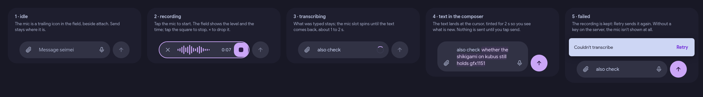

# Dictation in seimei (design, not built)

Status: for review. Based on the research in `~/Development/Scratch/asr-context/REPORT.md` (2026-10-27) and on dictate (`~/Development/Projects/dictate`, Mod+H on the laptop). Nothing here is built until the user has reviewed it.

## What changes

Today dictate builds its word list on the laptop from the focused window and its own history, and calls OpenRouter itself. The phone has no dictation. After this change:

- `seimei serve` has one ASR endpoint. A client sends audio and a small context hint; serve builds the word list, calls OpenRouter, cleans up the text, and returns it.
- The list comes from what seimei knows: the chat that is open, the shikigami that are running, the board, the projects. The phone and the laptop share it, along with the fixes and the miss log.
- The Android app (and the web client) get a mic in the composer. The text lands in the composer for editing and is never sent on its own.
- dictate becomes a thin client of the endpoint, and calls OpenRouter directly when seimei is down.

What stays the same: MAI-Transcribe-2 through OpenRouter with Azure's `phraseList`, voxtral-mini as the fallback, terms only (no chat sentences, no prompt), about 100 terms. The report measured that MAI ignores prompts and that lists of 150 junk-heavy words do worse.

## The endpoint

- `POST /api/asr`, with the same login as the rest of the API. The body is the audio as `audio/wav` (16 kHz mono s16, as dictate sends it today: 32 KB/s, so a 2 minute dictation is under 4 MB). The `X-Seimei-Asr` header carries the context hint as JSON.
- On the laptop, the same request goes to the unix socket `~/.local/share/seimei/asr.sock` (mode 600, peer uid checked, no token). It lives in the state dir, not the runtime dir, which can be made anew under a running serve (the 2026-10-27 crashes).
- The hint, all fields optional:
  - `chat`: what is open. `seimei`, `w:<worker id>` or `s:<session pid>`.
  - `window`: the focused window on the laptop, `{app_id, title, cwd}`. The repo name and its identifiers are worked out by serve, which runs on the same machine.
  - `screen`: where the phone is (`chat`, `agents`, `tasks`). The app cannot see other apps, and it won't try to.
  - `draft`: the text already in the composer. Only rare words are kept from it, like any other source.
- The reply: `{"text", "raw", "fixed": [[from, to]], "model", "ms", "cost"}`. `raw` is what the model returned and `text` is the text after the fixer.
- Calls go out on a keep-alive `reqwest` pool to `openrouter.ai/api/v1/audio/transcriptions`, the same JSON body as dictate: base64 audio, `provider.options.azure.phraseList` for MAI, and `context_bias` as one comma-joined string for voxtral. If MAI fails, voxtral is tried. On HTTP 400 the clip goes again without the list, as dictate does. The `JUNK` filter ("Thank you." on short clips) moves over with it.
- Config, `[asr]` in config.toml:
  - `key_file`, default `~/.config/dictate/or-key`, so the existing key is reused. Without a key, the mic isn't shown.
  - `model`, `fallback`, `vocab_max = 100`, `zdr`, `deny`.
  - `[asr.sources]`, one switch per source (below).

## The word list

The list is built per request, ranked, and capped at `vocab_max`. Sources, in rank order:

1. **Pins**: `asr/words.txt`, spelled the way they should come out. They always go first.
2. **The open chat**: rare words from its last 20 messages (user and assistant text only, no tool output), plus the agent's name and project. For the dispatcher it's seimei's own chat.
3. **Live names**: running shikigami and session names, project and repo names.
4. **The board**: rare words from the titles of open board items. Never whole titles.
5. **The focused window** on the laptop (title words, the repo of a kitty's cwd and its top 30 identifiers, as `vocab.context()` does today), or the `draft` words on the phone.
6. **Fill**: the nightly auto list (your own Claude turns and fish history, top 200 rare words), built by serve between 2 and 6 at night.

How the list is put together:

- **Rare.** A word is rare when dictate's `worth()` passes it: not English (hunspell en_US plus the 20k most common words, downloaded once into `asr/`), 3 to 30 characters, not a hash, not a file extension.
- **Ranking within a source.** Recency and count matter. A word from the last two messages outranks one from twenty messages back, so the list follows the conversation.
- **Merge.** Words are deduped case-insensitively, with the first spelling kept. Commas are dropped, since voxtral splits on them. The denylist goes last and always wins.
- **Cost.** Each source keeps a cached word table that is refreshed when its file changes (events, workers, tasks), so a request costs a merge of small lists, under a few ms.
- **Voxtral.** It gets the same terms, plus one short description as the first entry: "Dictation to seimei about <project> with <agent names>". It never gets chat text. The report measured that a description fixed "shikigami" and "Niri" on voxtral, and the eval decides whether description plus terms beats terms alone.

## After the model: a constrained fixer

1. **Shared fixes.** `asr/fixes` (`misheard -> right`, whole words, case-insensitive, longest first) is applied first, as today.
2. **Close to a listed term.** A suspect word, or a run of up to 3 words ("Ku bus"), is replaced by a term from this request's list when it is close to it. Close means a `difflib`-style ratio of at least 0.8, or the same phonetic key (Double Metaphone). The suspect must also not be an English word, so "build" never becomes "ebuild". Only terms that were in this request's list count: a term that wasn't sent can't be inserted.
3. **Logging.** Every replacement goes into the reply's `fixed` and into `asr/misses.log`. Suspects that stayed unfixed are logged as today, as material for new pins or fixes.

There is no LLM rewrite. The report found it adds 0.3 to 1 s and a second provider, and it can change what was said. If it ever comes, it comes as an opt-in for long dictations, limited to swapping words for list terms, and diff-checked.

**Shared corrections.** `asr/words.txt`, `asr/fixes` and `asr/misses.log` live in `~/.local/share/seimei/asr/`, and on the first start they're copied from dictate's files. When you edit dictated text in the composer before sending it, the app reports the edit (`{dictated, sent}`), and serve logs the changed words to misses.log as candidates. A candidate becomes a fix only when you add it (by hand, or later through a small seimei tool), so a typo fix on the phone never rewrites the laptop's output on its own.

## Clients

**Android.**
- The mic is a trailing icon in the composer field, next to attach. The send FAB stays as it is (send, or stop during a turn).
- It records with `AudioRecord` at 16 kHz mono and wraps the result in WAV. It needs the `RECORD_AUDIO` permission, asked on the first tap. minSdk is 30, so that's fine.
- Tap to start, tap the square to stop, × to drop the recording. It stops on its own after 2 minutes.
- The text is inserted at the cursor and tinted for 2 s. Nothing is sent until you tap send. If it fails, a snackbar says "Couldn't transcribe" with Retry, and the recording is kept until then.
- Mockup of the five states, drawn with the web client's own CSS (Catppuccin Mocha); the Android side follows the same final/ shapes: [asr/mockup.png](asr/mockup.png) (source [asr/mockup.html](asr/mockup.html)).

**Web.** It does the same in about 60 lines: `getUserMedia`, then an `AudioWorklet` that downsamples to 16 kHz PCM and wraps it in WAV. It works over the tunnel's https. It ships with Android if it stays that small; otherwise it comes later.

**Later.** The phone could split phrases with a VAD, as dictate does, so the text comes in while you speak. v1 is one recording and one request.

**dictate on the laptop.**
- It keeps its mic, VAD, speculative send and typing. Per phrase it posts the WAV and `{window}` to `asr.sock` and types the `text` that comes back.
- When the socket is missing or slow (no answer within 3 s), it falls back to its current direct OpenRouter path, with the list it can build alone: pins, window and auto, read from seimei's `asr/` files when they exist.
- The extra local hop costs well under the noise in MAI's own latency, so the eval checks only that the median doesn't move.

## Privacy

- **What goes out.** Terms only, as today, but more specific ones, since chat-derived words can include people's and clients' names.
- **Denylist.** `[asr] deny` holds words and globs. Board items or chats tagged private add nothing to the list.
- **Per-source switches.** `[asr.sources]` turns each of chat, names, board, window, draft and auto on or off. With everything off except pins, the list is what you pinned.
- **The send log.** `asr/sent.jsonl` gets one line per request: the time, the client, the model, every term sent with its source, the description, the audio length in seconds, and the cost. It holds no audio and no transcript. It rotates at 10 MB, and the usage tool can show it.
- **ZDR.** `[asr] zdr = true` sets `provider.zdr` on the request. Whether MAI's Azure endpoint qualifies isn't known yet (the report didn't check). The first build step checks it. If MAI has no ZDR endpoint, `zdr = true` means voxtral's `mistral/zdr` only, and the doc for the setting says so.

## Eval (before the switch, and after each change to the list or fixer)

A script, `contrib/asr_eval.py`, plays clips through either path and scores them. It runs each case twice and reports the median and p90.
- **Clips.**
  - dictate's 16 jargon clips (`~/Development/Scratch/dictate/jargon`, with `bias.json`).
  - Its 13 plain clips, plus about 20 new clean clips with no jargon (piper, two voices, a few through the laptop mic), to catch terms the model inserts that weren't said.
- **Paths.** Before: dictate direct with its own list. After: the endpoint with a fixed context fixture (a saved chat, board and worker snapshot), so the runs are reproducible.
- **Metrics.**
  - jargon accuracy, on the known terms;
  - WER on all clips;
  - inserted terms: list terms in the output that aren't in the reference, on the clean clips;
  - fixer hits and misses;
  - end-of-audio to text latency;
  - cost.
- **misses.log replay.** It holds text only, so the replay runs the old and new fixers over the logged phrases and counts how many suspects each resolves, and how many words it changed that it shouldn't have (checked by hand on that small set).
- **Pass bar.**
  - jargon accuracy at least dictate's 100% with 100 words;
  - WER no worse than 0.7%;
  - inserted terms at 0 on the clean clips;
  - median latency within 100 ms of dictate direct.

## Build order (once reviewed)

1. **Server core.** `crates/core/src/asr/` (`vocab.rs`: english, worth, sources, rank; `fix.rs`; `mod.rs`: the OpenRouter call), `POST /api/asr`, `asr.sock`, `[asr]` config, `sent.jsonl`, and the ZDR check.
2. **Eval, before and after.** The pass bar decides whether the list or the fixer changes.
3. **dictate as a client.** With its fallback, then a week of misses.log.
4. **Android mic.** Following the mockup, and the web mic if it stays small. App release.
5. **Docs.** `docs/config.md` (`[asr]`) and `docs/architecture.md`.
